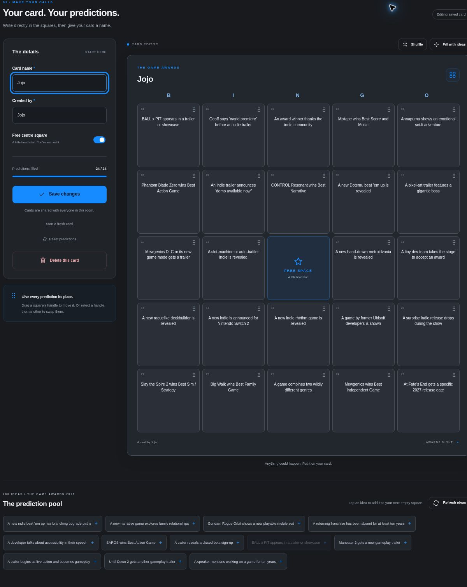

# Awards Night Bingo

**[Public interactive demo](https://joel-plourde.github.io/game-awards/bingo/demo/)** · **[Step-by-step self-hosting guide](docs/self-hosting.md)** · **[Edit and play guide](docs/user-guide.md)** · **[200 predictions and research](docs/predictions-2026.md)**

Create named 5 × 5 cards, drag or select two squares to swap them, browse your private group’s collection, and tap predictions during the show. Fill empty squares from 200 curated 2026 ideas. Reset predictions in the editor, reset marks in play mode, or delete saved cards after confirmation.

All app files live in this folder, including Supabase setup, scripts, tests, docs, screenshots, and the public demo. The live shared app requires a private invitation. The demo runs without Supabase.

## Self-host

1. Fork the repository and create your own Supabase project.
2. Apply this app’s SQL migration and configure your project endpoint and host origin.
3. Deploy its Edge Function.
4. Run `node scripts/create-room.mjs --site https://YOUR_USERNAME.github.io/YOUR_REPO/bingo/ --sample` from this folder, then run the generated SQL in your project.
5. Enable GitHub Pages from `main` and `/ (root)` and open your generated private invitation.

Follow the [complete guide](docs/self-hosting.md) for every dashboard step, the exact files, commands, screenshots, verification, and troubleshooting.

## Development

From the repository root, run `cd bingo`, then `npm test` and `npm run check`. No dependencies or frontend build step are needed. Coding agents should read [AGENTS.md](AGENTS.md) first; it is the shared project context regardless of agent vendor.

Original SVG/CSS artwork and screenshots. Predictions are speculative, not confirmed show announcements. Independent fan project, not affiliated with The Game Awards. [MIT license](../LICENSE).
