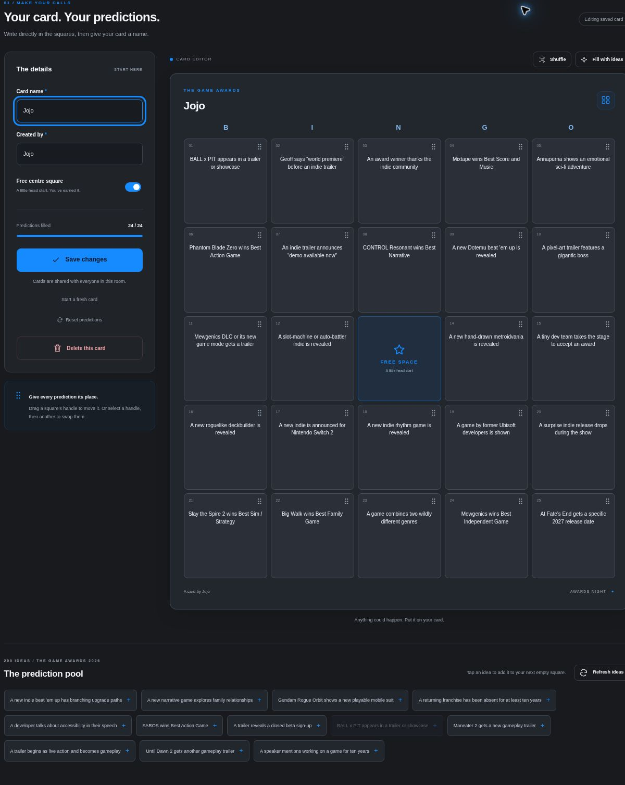
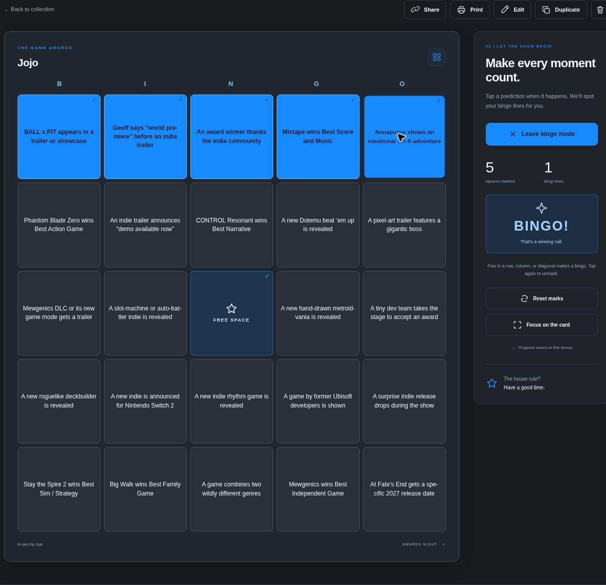
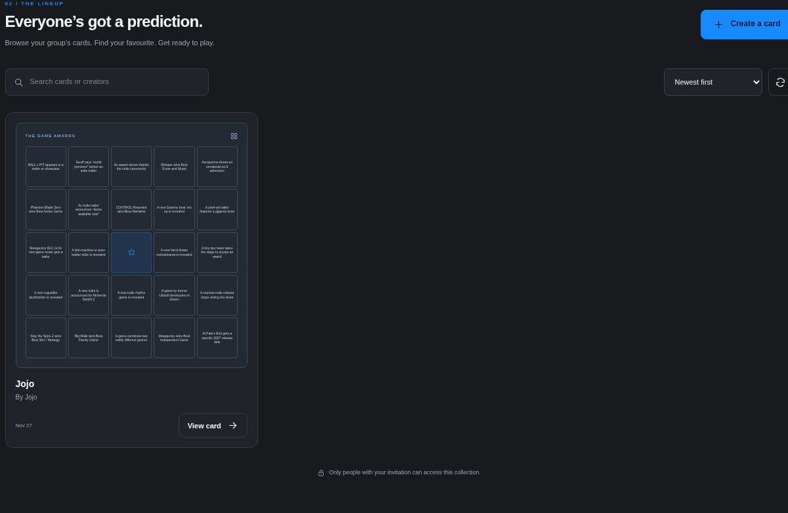

# Host your own Awards Night Bingo

Make an independent copy for your friends: your GitHub Pages site, your Supabase project, and your private invitation. No frontend framework, bundler, account system, or paid hosting plan is required by the code. Your provider’s limits and pricing still apply.

**[Try the public demo](https://joel-plourde.github.io/game-awards/bingo/demo/)** · [Editing and playing](user-guide.md) · [Prediction research](predictions-2026.md)



## What runs where

| Part | Where | Purpose |
| --- | --- | --- |
| `bingo/` | GitHub Pages or any HTTPS static host | Card editor, collection UI, and play mode |
| `demo/` | The same static host | Public sample; works without any database or invitation |
| `supabase/functions/awards-bingo/` | Your Supabase Edge Functions | Validates invitations and handles card operations |
| `bingo_private` schema | Your Supabase Postgres database | Rooms, invitation hashes, cards, and rate counters |
| Browser local storage | Each player’s browser | Unsaved drafts and play marks; not cross-device synchronization |

The HTML and repository are public. The saved collection is protected by server-side invitation validation. Everyone holding a room invitation can create, view, edit and delete that room’s cards. It is a group pass, not an individual account.

## 1. Fork the repository

You need GitHub and Supabase accounts, Git, and Node.js 20+ on your computer. Check Node with `node --version` and npm with `npm --version`. Install Node from its official distribution if needed.

On GitHub, open the repository, select **Fork → Create a new fork**, choose your account/repository name, and create the fork. This keeps the original separate from your copy.

Fork [joel-plourde/game-awards](https://github.com/joel-plourde/game-awards), then clone **your fork**:

```bash
git clone https://github.com/YOUR_USERNAME/YOUR_REPO.git
cd YOUR_REPO/bingo
```

All remaining terminal commands run from `bingo/`. Other gaming apps can live beside it.

The examples below use `https://YOUR_USERNAME.github.io/YOUR_REPO/bingo/`. Replace it with your actual URL. A custom domain or another HTTPS static host works too; preserve the `bingo/` path or adjust the URL accordingly.

## 2. Create your Supabase backend

### 2.1 Create the project

1. Sign in at the [Supabase dashboard](https://supabase.com/dashboard).
2. Select your organization and choose **New project**. Create an organization first if your account has none.
3. Give the project a recognizable name, such as `awards-night-bingo`.
4. Generate a strong database password and store it in your password manager. This app never needs that password in frontend source or Git.
5. Choose a region near your players. Review the selected organization’s plan and any displayed cost.
6. Create the project and wait for the database to finish starting. Continue when it is ready rather than provisioning or paused.

### 2.2 Record the project reference and URL

Your dashboard URL has this form:

```text
https://supabase.com/dashboard/project/PROJECT_REF
```

Copy the actual reference after `/project/`. The default project URL is:

```text
https://PROJECT_REF.supabase.co
```

You can verify that URL in the project’s **Connect** dialog. Use the same reference in the app configuration and deploy command. Do not substitute the project’s display name or database password.

This app does not need a publishable/anon key or a sign-up flow in the browser. The Edge Function authenticates room invitations.

### 2.3 Create the tables and API function

1. Open **SQL Editor** in the project sidebar.
2. Create a **new query** and name it `Bingo initial setup`.
3. Open [`supabase/migrations/20261127030840_awards_bingo_private_room.sql`](../supabase/migrations/20261127030840_awards_bingo_private_room.sql) in your fork. Use **Raw** or the copy-file button so you copy SQL rather than the surrounding GitHub page.
4. Paste the **entire file**, from schema creation to the final grant/comment, into the query editor.
5. Check that the dashboard still shows your intended project.
6. Click **Run** and wait for success. The schema, tables, indexes, RLS, and service-role-only API are created together.

Run the migration once against a fresh project. It does not create a room or invitation or copy anyone else’s saved cards. If `bingo_private` already exists, check whether setup was already completed; do not drop it to silence the error.

### 2.4 Verify the setup

In a second SQL Editor query, run:

```sql
select schemaname, tablename, rowsecurity
from pg_tables
where schemaname = 'bingo_private'
order by tablename;

select
  has_function_privilege(
    'anon', 'public.awards_bingo(text,text,jsonb,text)', 'execute'
  ) as anonymous_can_call_rpc,
  has_function_privilege(
    'authenticated', 'public.awards_bingo(text,text,jsonb,text)', 'execute'
  ) as authenticated_can_call_rpc;
```

Expect `card`, `rate_limit`, and `room`, each with `rowsecurity = true`. Both RPC permission values should be `false`.

A default `public` Table Editor view may not show this private schema. Use the schema selector when available, or inspect it through SQL Editor as the project owner. Do not expose private tables or add public policies to make them appear. The deny-by-default setup is intentional; players access the collection through the invitation-checking function.

## 3. Configure the three public settings

| File | Setting | Your value |
| --- | --- | --- |
| [`config.js`](../config.js) | `API_URL` | `https://PROJECT_REF.supabase.co/functions/v1/awards-bingo` |
| [`index.html`](../index.html) | CSP `connect-src` | `https://PROJECT_REF.supabase.co` |
| [`supabase/functions/awards-bingo/index.ts`](../supabase/functions/awards-bingo/index.ts) | `allowedOrigin` | `https://YOUR_USERNAME.github.io` |

### 3.1 Set the frontend endpoint

Open `bingo/config.js` in your editor. Replace the project reference in the `API_URL` line, keeping the function path unchanged:

```js
export const API_URL = 'https://PROJECT_REF.supabase.co/functions/v1/awards-bingo';
```

Save the file. This is an endpoint URL, not an API key.

### 3.2 Allow your backend in the page’s security policy

Open `bingo/index.html` and find the `<meta http-equiv="Content-Security-Policy" ...>` tag near the top. Inside its `content` value, change only the project hostname after `connect-src`:

```text
connect-src https://PROJECT_REF.supabase.co;
```

Keep the other security directives. Save the file. If this host still points at the original project, the browser will block your own endpoint even when `config.js` is correct.

### 3.3 Allow your website at the gateway

Open `bingo/supabase/functions/awards-bingo/index.ts`. Replace the `allowedOrigin` value:

```ts
const allowedOrigin = 'https://YOUR_USERNAME.github.io';
```

Save the file; deploy this updated copy in the next step. CORS checks use an origin rather than the full page URL.

The allowed origin is only the scheme and hostname. Do not include `/YOUR_REPO/bingo/` or a trailing slash. For a custom domain, use that domain’s origin instead.

The project URL is public configuration. **Never put a Supabase service-role key, secret API key, or raw invitation into frontend source, screenshots, README files, or GitHub commits.** The function reads its server-side key from Supabase’s built-in environment.

## 4. Deploy the Edge Function

Use the Supabase CLI from the `bingo/` folder. The commands below pin the CLI version whose deploy flags were checked for this project; `--use-api` bundles on Supabase and avoids needing Docker for this step.

```bash
npx supabase@2.101.0 login
npx supabase@2.101.0 functions deploy awards-bingo --project-ref PROJECT_REF --no-verify-jwt --use-api
```

`verify_jwt = false` is intentional for this function: the app uses invitation credentials instead of Supabase user accounts. The function and database RPC validate the invitation on every request. Disabling JWT checks on an arbitrary unprotected function would not provide the same access control.

### Dashboard alternative

To deploy without the CLI:

1. Select **Edge Functions** in your project sidebar.
2. Choose **Deploy a new function → Via Editor**.
3. Start from a blank or Hello World template and replace `index.ts` with the complete contents of [`supabase/functions/awards-bingo/index.ts`](../supabase/functions/awards-bingo/index.ts).
4. Confirm `allowedOrigin` contains your origin, for example `https://YOUR_USERNAME.github.io`, without a repository path or trailing slash.
5. Set the function name to **`awards-bingo`**.
6. Deploy and wait for success.
7. Open this function’s configuration/settings and turn off its platform **Verify JWT** setting. Some dashboards describe it as legacy JWT verification. This applies only to this invitation-authenticated function.
8. Confirm its URL is `https://PROJECT_REF.supabase.co/functions/v1/awards-bingo`.
9. Keep the local file in Git aligned with the deployed editor contents.

If your dashboard does not expose the JWT setting, use the CLI command above, which sets it explicitly. Supabase’s [dashboard quickstart](https://supabase.com/docs/guides/functions/quickstart-dashboard) documents the editor flow, and its [authorization reference](https://supabase.com/docs/guides/functions/auth-headers) explains the platform check.

Do not paste a service-role key into the page or install a frontend Supabase SDK. Supabase supplies the function’s server-side environment. If requests return 500, inspect function logs and recheck database setup before changing permissions.

## 5. Create a private invitation and optional sample card

Node.js 20 or newer is sufficient. This script uses built-in Node libraries and installs no dependencies:

```bash
node scripts/create-room.mjs --site https://YOUR_USERNAME.github.io/YOUR_REPO/bingo/ --name "Friends’ Game Awards" --sample
```

It prints:

- A short invitation and a long invitation for the same room.
- SQL containing only the two token hashes.
- With `--sample`, SQL that also inserts the Jojo sample card into your new room.

Open **SQL Editor → New query**, paste **only the generated SQL statement** (not the invitation links or terminal explanation), and click **Run** in your project. Record the returned `room_id` and, if requested, `sample_card_id`. Keep the private invitation somewhere safe, such as your password manager or a private bookmark. Do not commit the output or redirect it into a tracked file.

The script does not connect to Supabase, write a token file, or change the database by itself. The invitation works only after you run its SQL. Each execution creates a different invitation; to create one room, run one generated SQL statement.

Omit `--sample` for an empty room. To add an expiration:

```bash
node scripts/create-room.mjs --site https://YOUR_USERNAME.github.io/YOUR_REPO/bingo/ --expires 2027-01-01
```

Dates are interpreted by Node and printed as an explicit UTC timestamp. A date-only value means midnight UTC at the start of that date. The default has no automatic expiration.

## 6. Enable GitHub Pages

1. Commit and push your configuration changes to your fork’s `main` branch, using your normal Git workflow or GitHub’s file editor.
2. Open the repository and select **Settings**.
3. Select **Pages** in the sidebar under the code/planning/automation settings.
4. Under **Build and deployment → Source**, choose **Deploy from a branch**.
5. Select **main** and **/ (root)**, then **Save**. The root serves Bingo plus future sibling apps. Do not choose a docs folder.
6. Open **Actions** and wait for the Pages build/deployment to succeed.
7. Return to **Settings → Pages**, open the published site, and append `bingo/` to reach the app.

The root `.nojekyll` file is already included. No frontend build command is needed. GitHub’s [publishing-source instructions](https://docs.github.com/en/pages/getting-started-with-github-pages/configuring-a-publishing-source-for-your-github-pages-site) provide the current settings reference.

Open your generated private invitation. It should load the editor and, if you selected `--sample`, show **Jojo** in the card collection. A visit to the plain `/bingo/` URL should show the invitation gate.

The repository root is an app directory so you can host other gaming apps alongside `bingo/`. The public `/bingo/demo/` page works separately without a room or backend connection.

## 7. Verify your copy

Before sharing the invitation:

1. Open the plain `/bingo/` URL and confirm it asks for an invitation.
2. Open the invitation, create a named card, save it, and refresh to confirm it appears in the collection.
3. Open the card in another browser with the same invitation and confirm the shared card is visible.
4. Edit a square, save, and check that it updates.
5. Enter bingo mode and mark a row. Winning squares should turn blue.
6. Refresh and re-enter bingo mode to check marks persist on that browser.
7. Try an invalid invitation; it must not show the collection.

`npm test` checks pool size and uniqueness, card filling, conflicting winner avoidance, rearranging, bingo detection, and secure invitation generation. `npm run check` checks JavaScript syntax.

The optional [`tests/access.sql`](../tests/access.sql) performs database CRUD and isolation checks inside a transaction and rolls back all its test data. It is intended for an owner running checks in their own SQL Editor, not for exposing in the app.

## Edit and play examples

In edit mode, type directly in squares, move them with their handles, or fill empty squares from the 200-idea pool. **Reset predictions** clears the squares while retaining the name, creator, and free-space setting. For a saved card, that reset changes the shared version only when you save. **Delete this card** is available for saved cards and asks for confirmation.


In play mode, tap squares when the predictions happen. Rows, columns, and diagonals count. **Reset marks** clears play progress without changing the card. Marks belong to the current browser; two players can play the same saved card independently.



The collection contains saved cards for the invitation’s room. You can search by title or creator, share a direct private card link, print, or duplicate a card.



The [public interactive demo](https://joel-plourde.github.io/game-awards/bingo/demo/) shows edit and play modes without exposing a private room. It starts with a copy of Jojo’s sample, not the actual saved database card. Changes in the demo disappear on reload.

## Customize and maintain

- Styling: `styles.css`; branding and copy: `index.html`.
- Prediction entries and metadata: `ideas-2026.mjs`.
- Research, review date, and sources: [predictions-2026.md](predictions-2026.md).
- Public sample: `sample-card.mjs`. Changing it affects the demo and future `--sample` inserts, not cards already saved in Supabase.
- For a new awards year, review nominees and project status before editing the pool. Keep exactly 200 unique texts of at most 120 characters, or deliberately update the UI and tests if changing that contract.
- The current limits are 250 cards per room, 180 requests per minute per client hash, and 24 KB per function request. Change these deliberately in the SQL/function source if your group needs different limits.
- Editing any saved card creates a new version. Play progress from the old version resets; stale concurrent edits are rejected instead of overwriting someone else’s work.

Use **Invite friends** inside your own copy to share its private room. Do not use the public demo URL as a room invitation.

## Expire, revoke, or rotate an invitation

In your SQL Editor, target **your recorded room UUID**:

```sql
-- Temporarily revoke both invite aliases for this room.
update bingo_private.room
set revoked_at = now()
where id = 'YOUR_ROOM_UUID';

-- Restore this room's access, if it is not also expired.
update bingo_private.room
set revoked_at = null
where id = 'YOUR_ROOM_UUID';

-- Set an explicit expiration.
update bingo_private.room
set expires_at = '2027-01-01T00:00:00Z'
where id = 'YOUR_ROOM_UUID';
```

For rotation without losing cards, generate fresh links with `create-room.mjs`, copy **only the new hash values**, and update `token_hash` and `short_token_hash` on the existing room UUID. Do not run the generated INSERT if you intend to retain the existing room. Clear `revoked_at` and choose an expiration deliberately, then distribute the new links privately. Old links stop matching.

Back up both rooms and cards from your own Supabase database before manual maintenance. Hashes cannot recover a lost raw invitation; rotate it if needed.

## Troubleshooting

| Symptom | Check |
| --- | --- |
| The page always shows the invitation gate | Use the full `#invite=...` link; ensure you ran that script’s SQL in the same project as the deployed function. Check expiration/revocation. |
| “Could not reach the room” or a CORS error | Check `allowedOrigin`, the browser’s exact origin, the HTML CSP `connect-src`, and `config.js`. Redeploy the function after changing it. |
| 401 before your handler runs | Deploy with the documented invitation-auth configuration; confirm JWT verification is off for `awards-bingo`. |
| 500 from the function | Ensure the SQL migration is applied, the RPC is callable by `service_role`, and the function is deployed in the matching project. Check Supabase logs. |
| The collection is empty | A different invite may refer to a different room. The public demo never shows your private collection. |
| Play marks are missing on a different phone/browser | Expected: marks are per browser/device. Private cards, unlike marks, are stored in Supabase. |
| Marks reset after saving an edit | Expected: edited cards have a new version. |
| A stale edit is rejected | Open the latest card from the collection. Copy any wanted draft text before replacing it. |
| The page still shows older controls after a deployment | Wait for Pages to finish, then reload or hard-refresh. |
| The endpoint becomes unavailable after inactivity | Check the project’s state in the Supabase dashboard and restore it if paused. An open browser tab does not itself guarantee provider availability. |

## Working with a coding agent

The canonical context is [`bingo/AGENTS.md`](../AGENTS.md), a plain Markdown file for Codex, ChatGPT, Claude, OpenCode and other assistants. Tools differ in what they auto-load; explicitly ask yours to read it if necessary. No vendor-specific context file is required.

It records the folder boundary, source map, architecture, security invariants, behavior, research contract and test/deploy commands. Update it as the project evolves; never add credentials or raw invitations as context.

## Credits and license

Original app SVG/CSS artwork and screenshots of this repository’s own UI. The functional starting reference was [Bingo Baker](https://bingobaker.com/view/8890584); no artwork was copied from it. Game names and The Game Awards are owned by their respective rights holders. This is an independent fan project under the repository’s [MIT license](../../LICENSE).
