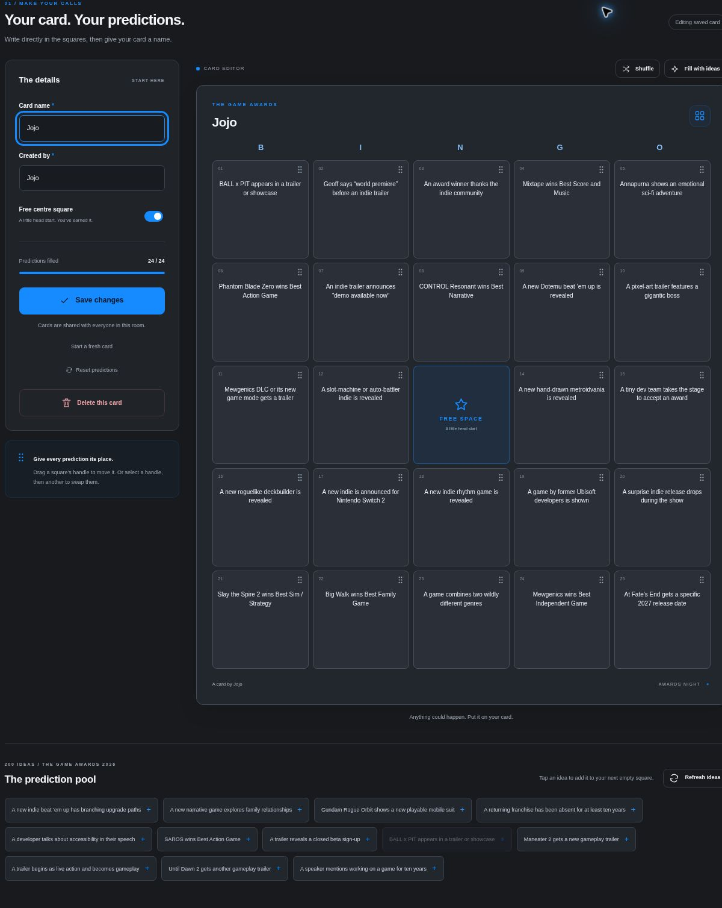
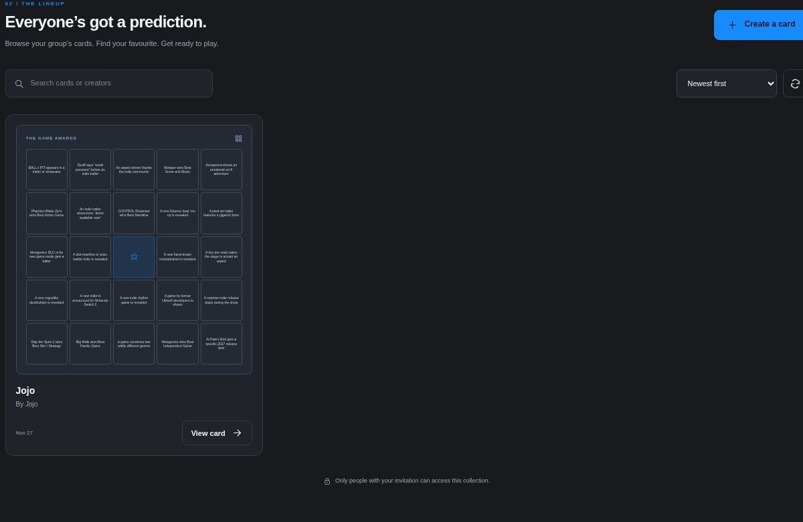
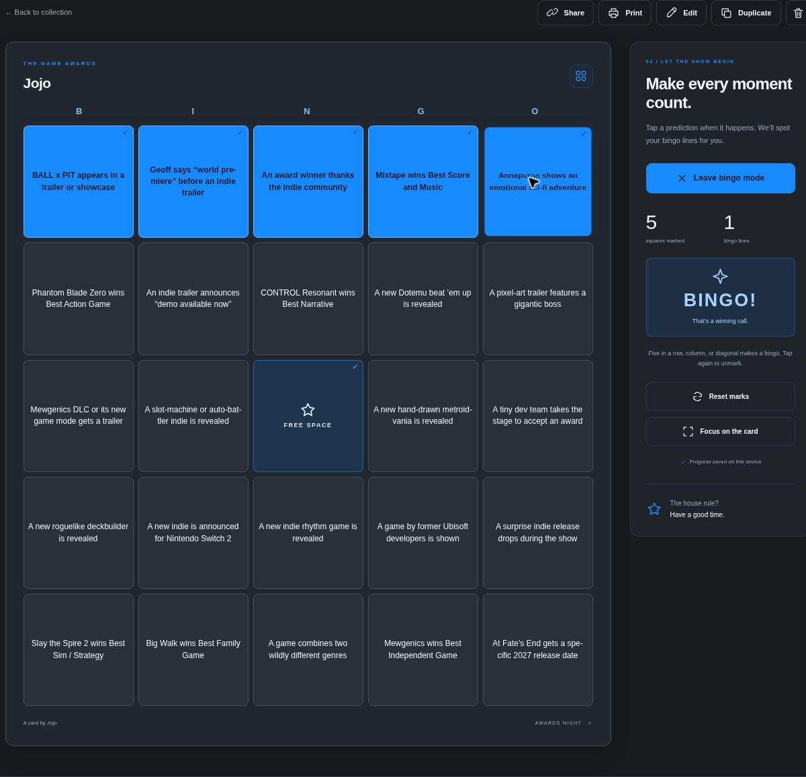

# Create, edit, and play

[Try the public demo](https://joel-plourde.github.io/game-awards/bingo/demo/) · [Host your own](self-hosting.md) · [All 200 ideas and research](predictions-2026.md)

## Create a card

Open your host’s private invitation, choose **Create a card**, enter a card name and creator, and type your predictions directly in the squares. The middle square is free by default; turn that off for 25 predictions.

**Fill with ideas** fills only empty squares from the complete 200-prediction pool for 2026. Your existing text stays. It avoids selecting competing winners for the same award or repeated reveal picks from the same project group. **Refresh ideas** changes the smaller suggestion selection below the board. Tap a suggestion to add it to your next empty square.

These are predictions, not promised announcements. The [research page](predictions-2026.md) distinguishes award picks, researched project predictions, long shots, and original show prompts.

## Arrange, reset, save, or delete

Drag a square’s handle to exchange it with another square. On touchscreens or with the keyboard, select one handle and then another. The free centre remains fixed. **Shuffle** rearranges the existing predictions without rewriting them.

**Reset predictions** clears the squares but keeps the card’s name, creator, and free-space setting. It asks for confirmation. If you are editing a saved card, click **Save changes** afterward to apply that reset to the shared collection. **Start a fresh card** clears the editor and starts a different card.

Save when all non-free squares are filled. Open a saved card and choose **Edit** to make changes. **Delete this card** appears in edit mode for saved cards. Deleting asks for confirmation and removes the card from the shared collection; unsaved edits to that card are discarded too.

## Browse your group’s cards

Use **The card collection** to see saved cards. Search by card name or creator, and sort the results. The collection refreshes every minute while visible; the refresh button fetches it immediately.

Open a card to view, share, print, duplicate, edit, or play it. Sharing a card includes the room invitation, so only send the link to people you want in the room. Anyone with the invitation can manage its cards.

## Play during the show

Open a saved card and choose **Enter bingo mode**. Tap a square when its prediction happens, and tap again to unmark it. Five marked squares in a row, column, or diagonal make a bingo; winning squares turn blue. The free centre is marked automatically.

**Reset marks** clears your play progress without changing the saved predictions. **Focus on the card** gives the board more space. Your marks are kept in this browser on this device, so other people can play the same saved card independently.

Saving an edited card creates a new version and starts new play progress for that version. Printing uses a paper-friendly layout.

## Try the demo

The [public interactive demo](https://joel-plourde.github.io/game-awards/bingo/demo/) starts with the Jojo sample card. You can edit, swap, shuffle, reset, fill, and play. **Restore Jojo sample** returns the demo to its original card. It does not connect to Supabase or change a real private card; demo edits disappear when you reload.
